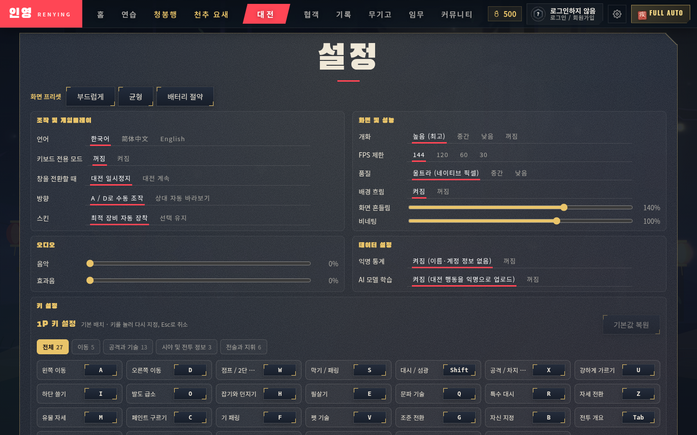
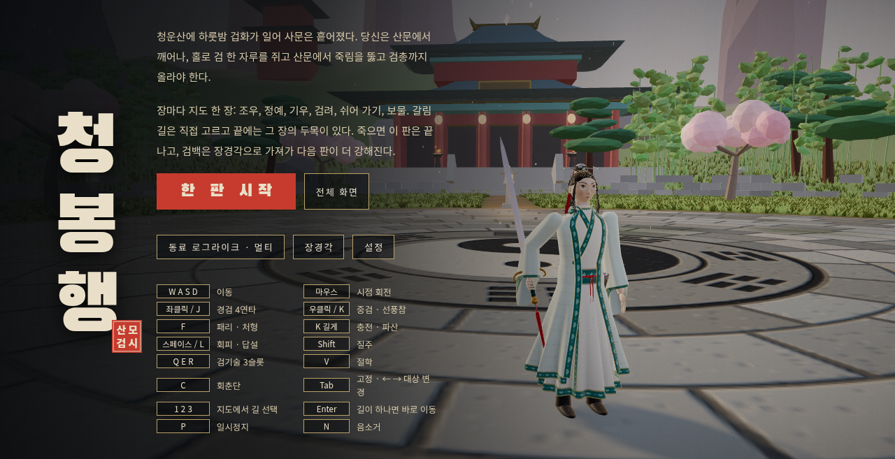
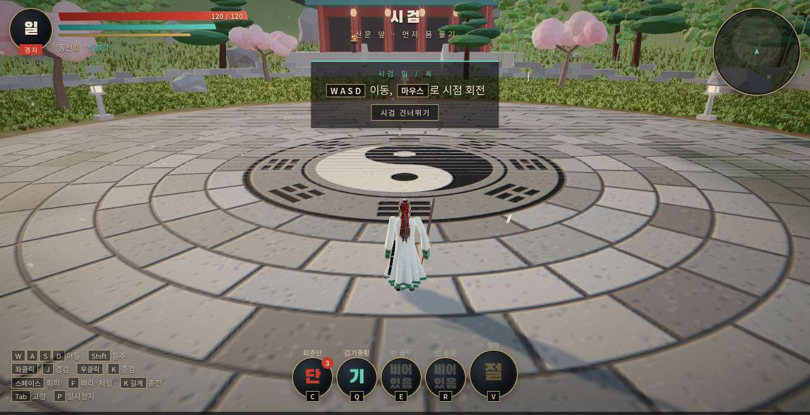

# 인영 (RenYing) 한글판

중국 무협풍 2D 격투 게임 **인영(RenYing)** 의 한국어 번역판입니다. 브라우저에서 바로 플레이할 수 있습니다.

- 플레이: https://sigco3111.github.io/renying-ko/
- 원작: https://github.com/BigBrainDevBros/RenYing (원작 페이지: https://bigbraindevbros.github.io/RenYing/)

## 한글화 범위
- 메뉴, 설정, 도감, 튜토리얼, 스토리, 훈련장, 대전/협동/난투 등 각 모드의 화면 문구와 캔버스 안 텍스트
- 동적으로 만들어지는 문구(정규식 템플릿 약 290개)와 사전 약 4,500개
- 한국어 글꼴(Noto Sans KR, Black Han Sans) 적용, 기본 언어는 한국어
- 설정에서 한국어 / 중국어 / 영어 전환 가능

## 스크린샷
| 도감 | 설정 |
|---|---|
|  |  |
| CPU 대전 | 훈련장 |
|  |  |
| 청풍행 메뉴 | 청풍행 시검 |
|  |  |

## 알려진 한계
- 메뉴 로고 刃影, 깃발의 武 같은 그림 요소는 원작 그대로 두었습니다.
- 청풍행(3D 미니게임) 문구 약 500개를 번역했지만, 전체 플레이를 끝까지 확인하지는 못해 일부 안내나 대사가 중국어로 남아 있을 수 있습니다.
- 온라인 기능은 원작 제작자의 서버(renying.evengao6688.workers.dev)와 PeerJS 중계를 그대로 사용합니다. 페이지를 열면 익명 플레이 통계와 접속자 수 확인 요청이 가고, 로그인과 클라우드 저장을 쓰면 계정과 진행 데이터가 그 서버에 저장됩니다. 한글판 운영자가 관리하는 서버가 아니며, 서버가 닫히면 해당 기능은 동작하지 않습니다.
- 터치 입력과 장시간 플레이는 검증하지 못했습니다.

## 라이선스와 크레딧
원작은 MIT 라이선스입니다. 원작 라이선스 파일(`license`)을 그대로 유지합니다.
원작 제작: Even, Luffy, Opus 5.5, Gemini 4 Argon / 한글화: sigco3111
